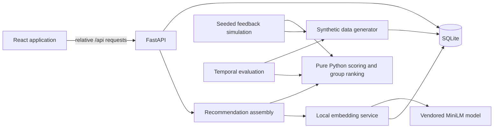

# Quorum

## Project Overview

Quorum helps college clubs choose events that fit member interests, availability, and group needs. It ranks event types and feasible dates and times, then gives organizers evidence for comparing and scheduling recommendations. The application runs locally and uses reproducible synthetic data for development and evaluation.

## Key Features

- Member preferences, weekly availability, and scheduling dealbreakers.
- Organizer recommendations with configurable group strategies, quorum, fairness, and diversity.
- Scheduling constraints for member availability, existing events, holidays, exam periods, and quorum.
- RSVP, attendance, and rating feedback that informs later recommendations.
- Organizers can schedule a recommendation and cancel upcoming events, which releases the slot.
- Deterministic explanations and counterfactuals based on computed evidence.
- Local authentication, SQLite persistence, and a vendored text-embedding model; no hosted services required.

## Tech Stack

- **Backend:** Python 3.11+, FastAPI, SQLAlchemy 2.x, SQLite.
- **Recommendation and evaluation:** NumPy, pandas, SciPy, scikit-learn, pytest, matplotlib.
- **Local semantic features:** sentence-transformers with CPU PyTorch and a vendored `all-MiniLM-L6-v2` model.
- **Frontend:** React 18 and Vite 8.

Python and npm dependencies are pinned in `requirements.txt` and `package-lock.json`.

## System Architecture



The site root (`/`) is a landing page with an in-browser demo sandbox that uses a simplified JavaScript engine on a small sample dataset; the real application is at `/app` and uses the Python backend. FastAPI serves the built frontend and API from one origin. During development, Vite proxies `/api` to FastAPI. Recommendation scoring is separated from database access and model inference in `backend/recsys`.

## Recommendation Engine

Member-event scores combine explicit event-type ratings, recency-weighted attendance, smoothed weekday/hour affinity, and (by default) similarity between local text embeddings of previously attended events and the candidate event description. History is restricted to the scoring cutoff. Evidence confidence controls each component's contribution; a member with no evidence falls back to the club's smoothed attendance rate for that event type and is marked cold start. Model files are loaded locally, and embeddings are cached in SQLite. Set `QUORUM_EMBEDDINGS_ENABLED=false` to disable this component.

Candidate generation checks availability, existing-event conflicts, holidays, exam weeks, and expected attendance against quorum. A member's latest-start dealbreaker removes only that member from a slot's available set; the slot is rejected only if quorum is then not met. Feasible candidates are ranked with average, least misery, most pleasure, multiplicative, Borda, approval voting, or average-without-misery. Optional fairness weighting prioritizes members with lower past satisfaction; MMR reranking reduces repeated event types. Explanations are deterministic templates over the computed evidence.

## Installation & Setup

Prerequisites: Python 3.11+, Node.js 20.19+, and npm.

```sh
npm ci
python -m pip install -r requirements.txt
cd backend
python -m app.seed --seed 42
cd ..
python tools/dev.py
```

Open `http://127.0.0.1:5173/app`. The database is created at `data/quorum.db`; seeding with the same value reproduces the same dataset. The generator and evaluation data are synthetic, not real club or member records. Demo logins are `organizer.acm@quorum.local` (password `QuorumOrganizer42!`) and `member.acm@quorum.local` (password `QuorumMember42!`); the other seeded clubs use the `design` and `ai-data` slugs in the same pattern.

Session cookies are not marked `Secure` by default because the app runs over local HTTP. Set `QUORUM_COOKIE_SECURE=true` (see `.env.example`) when serving behind HTTPS.

Run checks:

```sh
npm run verify
python -m pytest backend/tests -q
python tools/hardening_check.py
```

`npm run verify` exercises the landing-page demo engine and confirms the evaluation table on the landing page matches `results/evaluation`. These checks also run in GitHub Actions (`.github/workflows/ci.yml`).

Build and run the single-origin application:

```sh
npm run build
python -m uvicorn app.main:app --app-dir backend --host 127.0.0.1 --port 8000
```

## Evaluation

The newer planning engine has a separate, seeded evaluation page at `/app/evaluation`. Regenerate its JSON, CSV tables, and charts from the repository root with:

```sh
python -m backend.evaluation.planning_report --seed 42
```

The command uses a per-club chronological 70/30 split and saves tables in [`results/planning_evaluation`](results/planning_evaluation) and page data/charts in `public/evaluation`. It reports attendance-count MAE and Hit@3 against random, popularity, and repeat-last baselines; group conflict levels for average, least-misery, and fairness-aware ranking; and fairness/diversity ablations. Supply all seven research-schema CSV tables with `--real-csv-dir PATH` to evaluate real records separately. No real records are included, so the real-data section currently reports no results. Hit@3 measures agreement with organizers' past format choices, not recommendation correctness. Group satisfaction for unheld alternatives is estimated, and synthetic results are weak evidence for real clubs.

`backend/evaluation/runner.py` uses chronological 70/15/15 train, validation, and test splits across five seeds; tuning uses validation data only. Metrics include Precision@K, Recall@K, NDCG@K, event-type/slot hit rate, satisfaction, quorum success, Brier score, coverage, and intra-list diversity. Full results are in [`results/evaluation/REPORT.md`](results/evaluation/REPORT.md).

Reproduce the evaluation from the repository root:

```sh
cd backend
python -m evaluation.runner --seeds 42 43 44 45 46 --output ../results/evaluation
```

Against the validation-selected club-popularity baseline, the model's Brier score is no longer significantly different (0.189 vs. 0.191, paired 95% CI **[-0.009, +0.006]**, lower is better) — it was significantly *worse* (0.209) before the content-embedding weight below was tuned. Mean satisfaction is higher by **0.033** (95% CI **[0.010, 0.057]**). Precision@3, recall@3, NDCG@3, and event-type hit rate show no significant difference from the baseline either way.

`backend/recsys/config.py`'s `CONTENT_BASE_WEIGHT` was lowered from an untuned 0.20 to 0.05 for this reason: a validation-only search (see "Component weight tuning" in [`REPORT.md`](results/evaluation/REPORT.md)) found that dropping it all the way to 0 improves Brier score further but significantly worsens `satisfaction_gini` (member outcomes become less equal), conflicting with this project's own fairness machinery (`fairness_weights()`, the least-misery/fairness-aware strategies). 0.05 was then checked in isolation on the held-out test split (not just validation) against both the untuned 0.20 and the search's full-zero pick; see `results/evaluation/content_weight_isolated_comparison.csv` and `tools/content_weight_isolated_check.py`. It captures most of the Brier improvement (0.209 → 0.189, vs. 0.185 at content=0) for about a third of the fairness cost (`satisfaction_gini` 0.191 → 0.224, vs. 0.283 at content=0), with no measurable loss on `type_hit_rate` or `precision_at_3`. The full-zero option was deliberately not adopted for that reason, even though an automatic search would pick it every time.

`mean_satisfaction`, `min_satisfaction`, and the other satisfaction metrics are the model's own predicted scores for the event type each method selects, so they favor methods that agree with the scoring model; `type_hit_rate`, the ranking metrics, and Brier score compare predictions with what actually happened. After changing the model or evaluation code, rerun the command above and refresh the landing page table with `python tools/export_landing_results.py`.

These results are based only on synthetic behavior and descriptions. They are weak evidence and do not establish real-world improvements; offline history also cannot reveal attendance for events that were not held.

## Project Structure

```text
backend/
  app/             FastAPI routes, auth, persistence, and workflow
  recsys/          Pure scoring, candidate assessment, group ranking, explanations
  synthetic_data/  Seeded synthetic behavior and dataset generation
  simulation/      Recommendation/attendance/feedback simulation
  evaluation/      Temporal metrics, baselines, and reports
  tests/           Backend test suite
  models/          Vendored local embedding model
src/               React landing page (/) and member/organizer app (/app)
tools/             Dev server, hardening check, verification, landing results export
results/evaluation/ CSV metrics, report, and figures
data/               Local SQLite database (generated, git-ignored)
```

## License

No license is published for this repository. The vendored embedding model (`backend/models/all-MiniLM-L6-v2`) keeps its own upstream Apache-2.0 license regardless; see [`backend/models/README.md`](backend/models/README.md).
