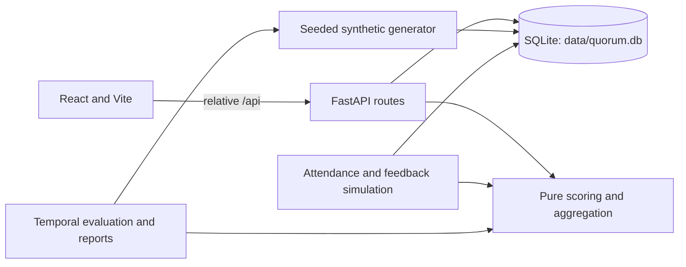

# Quorum

Quorum is a local-first group recommender that helps college clubs choose an event type, date, and start time. It combines member preferences, availability, attendance history, scheduling constraints, and configurable group decision strategies. The repository includes a deterministic synthetic dataset and temporal evaluation pipeline; it does not contain real club data.

## Requirements and setup

- Python 3.11+
- Node.js 20.19+ and npm
- GNU Make

```sh
make setup
make seed SEED=42
make test
make dev
```

`make dev` runs FastAPI on `127.0.0.1:8000` and Vite on `127.0.0.1:5173`; Vite proxies relative `/api` requests to FastAPI. Open the Vite address and visit `/app`. For the single-origin production mode, run `make build` followed by `make run`; FastAPI serves the built frontend and API together. No service, credentials, or outbound connection is required at runtime. Setup installs only the pinned local Python and npm dependencies.

Useful commands:

| Command | Purpose |
| --- | --- |
| `make seed SEED=42` | Rebuild `data/quorum.db` deterministically |
| `make test` | Run frontend invariants, Python tests, and local-only source checks |
| `make eval` | Run the five-seed temporal evaluation and write results |
| `make simulate SEED=42` | Run the feedback simulation |
| `make build` | Build the React application |
| `make run` | Serve the built application and API from one origin |

The database is SQLite at `data/quorum.db`. It enables foreign keys, WAL mode, and a busy timeout. A missing database is generated on server startup. Change `SEED` to reproduce an alternative synthetic dataset. On Windows, pass `PYTHON="py -3.11"` to Make, for example `make setup PYTHON="py -3.11"`.

## Demo accounts

`make seed` creates local-only demo accounts. The organizer password is `QuorumOrganizer42!`; the member password is `QuorumMember42!`.

| Club | Organizer | Member |
| --- | --- | --- |
| ACM & Robotics Guild | `organizer.acm@quorum.local` | `member.acm@quorum.local` |
| Design & Creative Commons | `organizer.design@quorum.local` | `member.design@quorum.local` |
| Student AI & Data Society | `organizer.ai-data@quorum.local` | `member.ai-data@quorum.local` |

These fixed credentials are for the synthetic local demo. Authentication uses Argon2id password hashes, SQLite-backed server-side sessions, HttpOnly SameSite cookies, CSRF tokens on state-changing requests, login throttling, and club-scoped role checks.

## Application workflow

Members can rate event types, set weekly availability, and choose a latest acceptable start time. Organizers choose aggregation, quorum, fairness, and diversity settings; inspect ranked candidates, member satisfaction, and explanations; run what-if recommendations; then accept a candidate to schedule it. Members RSVP, and organizers record attendance and ratings. Subsequent recommendations incorporate the feedback. Member attempts to create events or request organizer recommendations receive HTTP 403.

## Recommendation methodology

For each member and candidate event, Quorum computes three bounded signals:

1. **Explicit preference:** a rating `r` on the 1–5 scale maps to `(r - 1) / 4`.
2. **Implicit event-type response:** attended events contribute `1`, RSVP-yes no-shows `0.35`, and ignored events `0`. With recency enabled, each observation is weighted by `exp(-ln(2) × age_days / 120)`; the weighted mean is used.
3. **Time affinity:** the candidate weekday/hour attendance rate uses Laplace smoothing: `(successes + 1) / (observations + 2)`.

Each available signal is weighted by its configured base weight (0.50 explicit, 0.35 implicit, 0.15 time) multiplied by `n / (n + prior)`, then normalized across available signals. No evidence falls back to club popularity and is marked cold start. These settings are centralized in `backend/recsys/config.py`.

Candidates enumerate event type, date, and start time at one-hour increments over a configurable horizon. Availability, dealbreakers, existing events, holidays, exam periods, and quorum determine feasibility and reason codes. Expected attendance is the sum of member attendance probabilities; the default quorum is `max(5, ceil(0.30 × membership))`.

Group ranking supports average, least misery, most pleasure, multiplicative, Borda, approval voting, and average-without-misery. Fairness applies a normalized decaying boost to members with low historical satisfaction. MMR reranking promotes event-type diversity relative to recent and already selected recommendations. Explanations and “why not” counterfactuals are deterministic templates over the computed evidence; no language model is used.

## Architecture



`backend/recsys` contains deterministic scoring, candidate constraints, aggregation, and evidence rendering. It performs no persistence or network I/O. `backend/app` contains the API, authentication, database models, and workflow. `backend/simulation` and `backend/evaluation` isolate synthetic behavior, feedback simulation, and temporal measurement. The existing landing page remains at `/`; the application workflow is under `/app`.

## Evaluation

Run `make eval` to evaluate five deterministic seeds with a chronological 70/15/15 train/validation/test split. Tuning uses validation data only. Per-seed CSVs, 95% confidence intervals, paired comparisons, figures, and a report are written to `results/evaluation/`.

The evaluation measures Precision@K, Recall@K, NDCG@K, event-type and slot hit rates; mean/minimum satisfaction, satisfaction spread and Gini; quorum success; Brier calibration; coverage; and intra-list diversity. Baselines are random, club popularity, most recent type, same-week-last-year, and individual aggregation strategies. Ablations remove recency, time affinity, fairness, or diversity.

The checked-in five-seed report shows that the model **does not beat club popularity** on Precision@3, Recall@3, NDCG@3, or event-type hit rate. Predicted mean/minimum satisfaction, coverage, and diversity improve; calibration gains are inconclusive; satisfaction standard deviation increases. Historical slot hit rate and quorum success are unchanged because the temporal data cannot reveal counterfactual attendance for events that were not held. These results are synthetic and should not be interpreted as evidence of real-world effectiveness.

Suggested report outline: (1) data generation and temporal split; (2) individual ranking metrics and baselines; (3) group satisfaction, fairness, and quorum outcomes; (4) calibration and coverage; (5) paired intervals and ablations; (6) limitations and metrics where the model loses. Use `results/evaluation/REPORT.md` as the generated results source.

## Synthetic data and assumptions

The seeded generator creates three clubs, 25–60 members per club, twelve event types, and 18 months of synthetic event history. Hidden personas, time-slot fit, exam-week dips, repeat-event fatigue, and noise generate behavior; hidden persona fields are excluded from recommender inputs. Data includes cold-start, sparse-history, and interest-drifting members. The simulation generates attendance from this behavior model, independently of recommender features.

Assumptions and limitations:

- Historical attendance is an imperfect proxy for interest; nonattendance can reflect factors missing from the model.
- Weekly availability and one-hour slots simplify real scheduling constraints.
- Candidate attendance probabilities are treated as additive expected attendance; member responses may be correlated.
- Synthetic behavior is designed for reproducibility, not to represent a specific college or population.
- Offline evaluation is observational and cannot measure the outcome of unheld alternatives.
- Fairness weights and group strategies express configurable trade-offs, not a universal definition of fairness.

## Three-minute demo

1. Run `make seed SEED=42` and `make dev`, then open `/app`.
2. Sign in as `organizer.acm@quorum.local` with `QuorumOrganizer42!`; set strategy, quorum, fairness, and diversity, then request recommendations.
3. Open a recommendation to review per-member satisfaction, constraints, and its “why not” alternatives. Accept it to create an event.
4. Sign in as `member.acm@quorum.local` with `QuorumMember42!`, submit an RSVP, then return as organizer to record attendance and ratings.
5. Run recommendations again to see the feedback reflected. For reproducible offline metrics, run `make eval` and review `results/evaluation/REPORT.md`.

## Hardening and known issues

The Python test suite blocks socket connection attempts for every test. `python tools/hardening_check.py` scans runtime source for hosted database references, external URLs and CDNs, unsafe HTML insertion, and verifies the self-only `connect-src` policy. `make test` includes this check.

| Issue | Severity | Fix or status |
| --- | --- | --- |
| Runtime network access or hosted-service dependency | Critical | Removed; suite blocks socket connections and source checks enforce local-only references. |
| SQL injection through request strings | Critical | ORM-bound parameters and validated request schemas; adversarial API inputs are covered by tests. |
| Stored XSS in member-visible event text | High | React text rendering escapes venue content; malicious content is round-tripped as data in tests and unsafe HTML insertion is scanned. |
| Unauthorized scheduling, missing CSRF, or cross-club access | Critical | Session, CSRF, role, and club-boundary integration tests cover authorization. |
| Large production JavaScript bundle | Low | Vite reports a size advisory; the complete existing landing experience and `/app` workflow remain in one build. |
| Synthetic evaluation does not establish real-world lift | High | Reported as a limitation; no superiority claim is made where baseline comparisons do not support one. |
