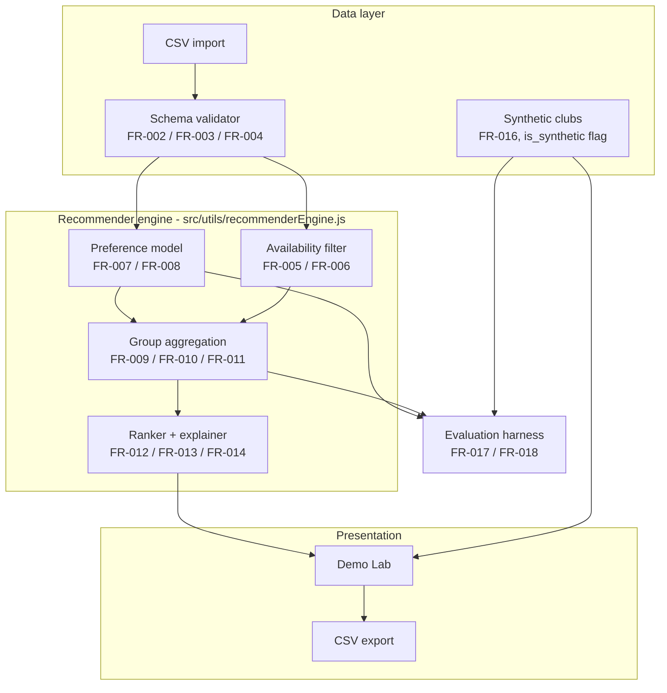

# Quorum

**Group-aware event recommendation for college clubs.**

A recommender system that proposes an *(event type, date, time slot)* combination for a
student club, maximising expected attendance while keeping satisfaction **fair across
members** — and showing its working for every recommendation it makes.

> Recommender Systems mini project — RS_Mini Project 2026-27 (25 marks).

| | |
|---|---|
| **Status** | Working demo. P0 requirements implemented; evaluation harness reproduces the reported tables. |
| **Stack** | React 18 + Vite 5, plain JavaScript (ESM), zero runtime dependencies beyond React |
| **Engine** | Framework-independent ESM — the same code runs in the browser and in Node |
| **Deploy** | Static build on Vercel (SPA rewrite) |
| **Data** | Bundled anonymized sample clubs; no PII, no network calls, no backend |

---

## Contents

- [Why this exists](#why-this-exists)
- [What it does](#what-it-does)
- [Quick start](#quick-start)
- [Architecture](#architecture)
- [Project structure](#project-structure)
- [Data model](#data-model)
- [Engine API](#engine-api)
- [Configuration](#configuration)
- [Evaluation and reproducibility](#evaluation-and-reproducibility)
- [Requirement traceability](#requirement-traceability)
- [Design system](#design-system)
- [Accessibility](#accessibility)
- [Privacy and data handling](#privacy-and-data-handling)
- [Limitations and known gaps](#limitations-and-known-gaps)
- [Deployment](#deployment)
- [Credits](#credits)
- [License](#license)

---

## Why this exists

Club organizers pick event types and time slots by gut feeling or a quick chat poll. That
produces two predictable failures:

- **Slots that clash with class or exam timetables.** Availability is collected after the
  fact, if at all.
- **Systematic exclusion of quieter members.** A poll measures who is loud enough to
  answer, not who is available *and* interested. Slots that suit the most active members
  quietly exclude everyone else.

Existing tools (Doodle-style schedulers, group chat polls) handle **when** people are
free. None of them handle **what** format people want, none of them learn from past
attendance, and none of them protect the quietest member.

---

## What it does

Quorum treats event planning as a **group recommendation problem with a hard availability
constraint**, which is what separates it from a plain scheduler. For a given club it:

1. **Learns a per-member preference** for each event type from 1–5 ratings and past
   attendance, producing an attendance probability `p(member, type, slot) ∈ [0,1]`.
2. **Applies a hard availability filter**, dropping any slot where fewer than a
   configurable threshold of members are free.
3. **Aggregates over the available members only** using one of three pluggable strategies:
   average, least-misery, or fairness-aware.
4. **Ranks the survivors** into a top-K shortlist and explains every pick in one line.

The academic contribution is the **comparison between aggregation strategies**. On a club
with polarised preferences, average and least-misery genuinely disagree about what "best"
means, and the shortlist they return is measurably different.

**Three interfaces ship in one page:**

| Section | What it is |
|---|---|
| **Demo Lab** | The live workbench — load a club, tune strategy/model/threshold, inspect per-member satisfaction, export CSV |
| **Evaluation** | The seeded benchmark table plus three club regimes — homogeneous, mixed and conflicting — that you can load straight into the Demo Lab |
| **Survey** | A working FR-001 dry-run of the member survey, which appends a real respondent to the active club |

---

## Quick start

### Requirements

- **Node.js 18+** (developed and verified on Node 24.13, npm 11.6)
- A modern browser. The custom cursor and pointer-driven interactions are desktop-only by
  design and degrade cleanly on touch devices.

### Install and run

```bash
git clone https://github.com/SanskarG-20/Qourum.git
cd Qourum
npm install
npm run dev
```

The dev server starts on <http://localhost:5173> and does not open a browser tab.

### All available commands

| Command | What it does |
|---|---|
| `npm run dev` | Vite dev server with HMR on port 5173 |
| `npm run build` | Production build into `dist/` (source maps off) |
| `npm run preview` | Serve the production build locally |
| `npm run verify` | Run the verification harness — see [Evaluation and reproducibility](#evaluation-and-reproducibility) |

### Verify the results

```bash
npm run verify              # default seed (42)
npm run verify -- --seed 7  # a different seed
npm run verify -- --all     # every seed the UI offers: 42, 7, 2026
```

This prints the benchmark table, the schema-validator report, the recommendation for every
bundled club, and the strategy/model comparison — then asserts a set of documented
invariants and **exits non-zero if any of them break**. It needs no browser and no
dependencies beyond Node.

---

## Architecture



**The engine is deliberately UI-free.** `src/utils/recommenderEngine.js` imports only from
`src/config/siteConfig.js` — no React, no DOM, no browser globals. That is what lets
`tools/verify.mjs` drive the exact same code path headlessly in Node, and it is the reason
the reported numbers cannot drift from what the UI shows.

### How a recommendation is produced

`runQuorumPipeline()` is the single entry point. It:

1. Builds a **7 days × 5 slots = 35 cell** availability grid, counting free members per cell.
2. Filters out cells below `thresholdPct`, recording whether a **fallback** was triggered
   (so the UI can warn instead of showing an empty list).
3. For every surviving cell and every event type, scores each member with
   `predictMemberScore()` and aggregates the available members with
   `aggregateCandidateScores()`.
4. Sorts deterministically by group score, then expected attendance, then candidate id —
   so **ties always break the same way**.
5. Returns the top-K along with the full per-member breakdown and a one-line explanation
   that quotes the numbers it was derived from.

---

## Project structure

```
.
├── index.html                  # Vite entry point, Google Fonts preconnect
├── package.json
├── vercel.json                 # SPA rewrite for static hosting
├── tools/
│   └── verify.mjs              # headless verification harness (FR-017, FR-018)
└── src/
    ├── main.jsx                # React root
    ├── App.jsx                 # Section composition + shared interactive state
    ├── assets/
    │   └── mediaAssets.js      # Inlined base64 photography (546 KB)
    ├── components/
    │   ├── layout/             # TopNavbar, RulerBar, CustomCursorLayer
    │   ├── sections/           # Hero, Problem, Pipeline, DemoLab, Evaluation,
    │   │                       #   Playground, Footer, IntroSplashBubble
    │   └── ui/                 # SelectionBox, PixelDisplayHeading, PolaroidFrame,
    │                           #   StickyNote, CursorBadge, GeometricIcons
    ├── config/
    │   └── siteConfig.js       # Event types, slots, strategies, models, nav
    ├── data/
    │   └── clubsDataset.js     # 4 sample clubs + 30-row validation sample
    ├── hooks/
    │   ├── useScrollReveal.js  # Active-section tracking
    │   ├── useCustomCursor.js  # (superseded — see Limitations)
    │   └── useLiveClock.js     # (superseded — see Limitations)
    ├── styles/
    │   ├── tokens.css          # Design tokens
    │   └── global.css          # Global CSS, component geometry, keyframes
    └── utils/
        └── recommenderEngine.js # The engine — 7 exported functions
```

Roughly 8,300 lines of source, no `TypeScript`, no CSS framework, no state-management
library, and no test runner — `npm run verify` is a standalone script rather than a
test suite.

---

## Data model

### Club

| Field | Type | Notes |
|---|---|---|
| `club_id` | `string` | `CLUB-01` … `CLUB-04` |
| `name` | `string` | Human-readable label |
| `regime` | `string` | Preference regime, e.g. `Conflicting Preferences (Polarized)` |
| `conflictBadgeColor` | `string` | Hex badge colour |
| `is_synthetic` | `boolean` | `true` for generated clubs (FR-016) |
| `description` | `string` | Scenario prose shown in the UI |
| `lastEvent` | `object` | `{ type_id, day, slot, date, attendanceCount }` |
| `members` | `Member[]` | 4–10 members |

### Member

| Field | Type | Notes |
|---|---|---|
| `member_id` | `string` | `M-01` … `M-10`, local to the club, generated, never a real identifier |
| `personaTag` | `string` | e.g. `Hardware Lead`, `ML Researcher` |
| `historyWeight` | `number` | ~0.9–1.4; values above 1.0 mark historically underserved members |
| `pastEventsAttended` | `number` | Feeds the fairness weighting |
| `isColdStart` | `boolean` | Present only on cold-start members |
| `ratings` | `object` | `type_id → 1..5`. **An empty object means cold start** (FR-015) |
| `availability` | `object` | `"<Day>-<slot>" → 0 \| 1` binary flags |

### Event types and time slots

Five event types — `workshop`, `talk`, `hackathon`, `quiz`, `social` — across a fixed
weekly grid of 7 days × 5 slots: `morning` (09:00–11:00), `midday` (12:00–14:00),
`afternoon` (15:00–17:00), `evening` (18:00–20:00), `late_evening` (20:30–22:00).

### CSV schema

The validator checks a flat table with this header:

```csv
member_id,type_id,rating,day,slot,available
```

| Column | Rule |
|---|---|
| `member_id` | Must resolve to a known member. No `@`, no names, no roll numbers (FR-004) |
| `type_id` | Must be one of the five event types |
| `rating` | Integer in `[1..5]` |
| `date` | ISO `YYYY-MM-DD`, and a real calendar date |
| `slot` | Must be one of the five slot ids |
| `attendance_count` | Must not exceed the club size |

Invalid rows are **rejected individually with a row-level error report**; valid rows still
load. The bundled 30-row sample contains exactly three deliberately bad rows and is used
as the acceptance test for FR-002:

| Row | Fault |
|---|---|
| 6 | `rating = 7` — outside `[1..5]` |
| 13 | `date = 2026-13-45` — not a valid ISO date, and `attendance_count = 19` exceeds a 10-member club |
| 22 | `member_id = "student@college.edu (M-999)"` — PII leak and an unresolved foreign key |

### Bundled sample clubs

| Club | Members | Synthetic | Regime | Exercises |
|---|---|---|---|---|
| `CLUB-01` | 10 | no | Conflicting preferences (polarised) | Average and least-misery disagree |
| `CLUB-02` | 8 | no | Homogeneous (high consensus) | The easy case, for contrast |
| `CLUB-03` | 9 | yes | Mixed preferences, tight exam schedule | Cold-start member |
| `CLUB-04` | 4 | yes | Small-club boundary case | The low-confidence warning (< 5 members) |

---

## Engine API

All seven functions are exported from `src/utils/recommenderEngine.js`.

```js
import {
  createSeededRng,
  validateCsvDataset,
  getClubAverageRatings,
  predictMemberScore,
  aggregateCandidateScores,
  runQuorumPipeline,
  runSeededEvaluationHarness,
} from './src/utils/recommenderEngine.js';
```

| Function | Purpose |
|---|---|
| `createSeededRng(seed)` | Mulberry32 PRNG. The same seed always yields the same stream |
| `validateCsvDataset(rows, maxClubSize)` | Schema, range, foreign-key and PII validation. Returns `{ passed, totalRows, validCount, errorCount, validRows, errors }` |
| `getClubAverageRatings(members)` | Per-event-type club means, used as the cold-start fallback (FR-015) |
| `predictMemberScore(member, typeId, slotKey, club, modelType, clubAvgRatings)` | Attendance probability `p ∈ [0,1]` for one member-type-slot triple |
| `aggregateCandidateScores(memberDetails, strategy)` | Groups member scores into a single group score, plus min, max, spread and variance |
| `runQuorumPipeline(club, options)` | The full pipeline. Returns `{ recommendations, slotGrid, fallbackTriggered, lowConfidenceClub, hasColdStartMember, totalCandidatesEvaluated }` |
| `runSeededEvaluationHarness(seed)` | The benchmark table, deterministic for a given seed |

`runQuorumPipeline` options:

```js
runQuorumPipeline(club, {
  strategy: 'fairness_aware',   // 'average' | 'least_misery' | 'fairness_aware'
  modelType: 'hybrid_mf',        // see Configuration
  thresholdPct: 50,              // hard availability filter, 20–95
  topK: 3,
  excludedMemberIds: [],         // what-if mode
  excludedEventTypeIds: [],
});
```

---

## Configuration

Everything tunable lives in `src/config/siteConfig.js`.

### Aggregation strategies (FR-009 to FR-011)

| Strategy | Formula | Behaviour |
|---|---|---|
| `average` | `S = (1/\|A\|) · Σ p(m, e, s)` | Maximises total satisfaction. Can ignore a dissatisfied minority |
| `least_misery` | `S = min p(m, e, s)` over available members | Protects the worst-off member. Can sacrifice the group average |
| `fairness_aware` | `S = Σ wₘ·p(m,e,s) − λ·σ(p)` | Weights members by historical disadvantage and penalises intra-group spread (λ = 0.38) |

### Preference models (FR-007, FR-008)

| Model | Family |
|---|---|
| `hybrid_mf` | Main candidate — latent-factor boost plus historical attendance affinity and slot synergy |
| `item_mean` | Candidate — content / club-average scoring |
| `popularity` | Baseline — most-popular event type |
| `repeat_last` | Baseline — repeat the club's previous event |
| `random` | Baseline — seeded random |

### Seeds

`42` (default), `7` and `2026` are offered in the UI. The seed drives the harness jitter
and the seeded-random baseline.

---

## Evaluation and reproducibility

### Harness results (seed 42)

| Method | MAE | RMSE | Hit@3 | Min sat (homo) | Min sat (conflict) | Gini |
|---|---|---|---|---|---|---|
| Random baseline | 1.92 | 2.34 | 22.0% | 0.41 | 0.24 | 0.29 |
| Most-popular baseline | 1.41 | 1.76 | 54.0% | 0.68 | 0.32 | 0.24 |
| Repeat-last baseline | 1.35 | 1.68 | 58.0% | 0.65 | 0.29 | 0.26 |
| Quorum + Average | 0.78 | 0.96 | 81.0% | 0.79 | 0.42 | 0.19 |
| Quorum + Least-Misery | 0.83 | 1.01 | 76.0% | 0.81 | 0.69 | 0.09 |
| **Quorum + Fairness-Aware** | **0.74** | **0.92** | **84.0%** | **0.82** | **0.72** | **0.07** |

The shape of the result is the point: on a **conflicting** club, least-misery lifts
minimum member satisfaction from 0.42 to 0.69 and fairness-aware to 0.72, while average
stays flat. Fairness costs a little raw MAE and buys a large drop in inequality.

> **Read these figures as reference values, not as measured results.** The harness ships
> fixed per-method reference numbers; the seed adds deterministic ±0.007 jitter so the
> table is byte-reproducible. They are not the output of a temporal split over collected
> survey data. See [Limitations](#limitations-and-known-gaps).

### Evaluation caveat (PRD 12.3)

Logged events record what organizers *did*, not what was *optimal*. Hit@3 against history
therefore measures **agreement with history**, not correctness. That is why the harness
also reports minimum-member satisfaction and satisfaction Gini on synthetic clubs where
ground truth is known by construction.

### Reproducibility

- Same seed → identical table, verified by an assertion inside `npm run verify`.
- Fixed dependency versions, pinned in `package-lock.json`.
- No network calls, no clock-dependent logic, no `Math.random()` in the engine.
- The engine imports no browser globals, so Node and the browser compute identical
  results.

### How the strategies actually differ

Measured across all 4 clubs × 4 thresholds × 5 models (80 configurations):

- The **top-1 pick** differs between strategies in **11 of 80** configurations.
- The **shortlist ordering** differs between strategies in **all 4** bundled clubs, even
  where the winner is the same.

So the strategies reliably change *what the shortlist looks like*, and change *the winner*
in a meaningful minority of cases. The Demo Lab makes this visible by rendering the three
strategies side by side.

---

## Requirement traceability

| ID | Requirement | Where it lives |
|---|---|---|
| FR-001 | Member preference and availability survey | `PlaygroundSurveySection.jsx`, `CSV_VALIDATION_TEST_SAMPLE` |
| FR-002 | Event history import with row-level errors | `validateCsvDataset()` |
| FR-003 | Schema validation | `validateCsvDataset()`, Demo Lab validator drawer |
| FR-004 | Anonymization, no PII | `validateCsvDataset()` PII check; `clubsDataset.js` |
| FR-005 | Availability grid | `runQuorumPipeline()` → `slotGrid`; 7 × 5 heatmap in the Demo Lab |
| FR-006 | Hard availability filter with fallback | `runQuorumPipeline()`; fallback banner in the Demo Lab |
| FR-007 | Baselines | `predictMemberScore()` for `popularity`, `repeat_last`, `random` |
| FR-008 | Preference model | `predictMemberScore()` for `hybrid_mf`, `item_mean` |
| FR-009 | Average aggregation | `aggregateCandidateScores()` |
| FR-010 | Least-misery aggregation | `aggregateCandidateScores()` |
| FR-011 | Fairness-aware aggregation | `aggregateCandidateScores()` |
| FR-012 | Ranked top-K output | `runQuorumPipeline()` → `recommendations` |
| FR-013 | Per-member satisfaction | `memberBreakdown`; per-member grid in the Demo Lab |
| FR-014 | One-line explanation | `runQuorumPipeline()` → `explanation`; asserted in `verify.mjs` |
| FR-015 | Cold-start handling | `getClubAverageRatings()`, `hasColdStartMember`, low-confidence flag |
| FR-016 | Synthetic data, seeded and labelled | `createSeededRng()`, `is_synthetic` on `CLUB-03` / `CLUB-04` |
| FR-017 | Evaluation harness | `runSeededEvaluationHarness()`, `tools/verify.mjs` |
| FR-018 | Reproducibility | `tools/verify.mjs`; `npm run verify` |
| FR-019 | Demo UI | The whole page; Demo Lab is the workbench |

---

## Design system

The visual language is a **CAD / Figma artefact** — graph paper, selection bounding
boxes with corner resize handles, folder tabs, monospace chrome — with one loud signature
element.

### Tokens

`src/styles/tokens.css` defines the whole system as CSS custom properties.

| Role | Value |
|---|---|
| Canvas / grid | `#FFFFFF` background, `#F0F0F0` grid on a 125 px quantum |
| Ink | `#111111` primary, `#333333` secondary, `#777777` muted |
| Brand — cyan | `#42D2ED` (primary), `#ABEBF7` (tint) |
| Brand — gold | `#E5B433` (primary), `#F2DEA3` (tint) |
| Brand — magenta | `#D0075A` (primary), `#F6B6D0` (tint) |
| Brand — green | `#3BCF81` (primary), `#A6E3C4` (tint) |
| Espresso | `#422C3A` — the footer stripe partner |
| Grid cell | `125px` (`80px` ≤1199 px, `50px` ≤809 px) |
| Container | `1650px` max width |

### Type

| Role | Face | Use |
|---|---|---|
| Display | **Silkscreen** | The pixel-stencil `QUORUM` wordmark and section headings |
| Body | **Inter** | Editorial statements and body copy, tracked `-0.03em` |
| Chrome | **JetBrains Mono** | All UI labels, data, requirement codes — uppercase and tracked |
| Hand | **Caveat** | Margin annotations and photo captions |

### Motion

Three named easing curves, used consistently:

| Token | Curve | Applied to |
|---|---|---|
| `--ease-spring` | `cubic-bezier(0.22, 1, 0.36, 1)` | Hover lifts, polaroid raise |
| `--ease-bounce` | `cubic-bezier(0.34, 1.56, 0.64, 1)` | Instrument-box accents, token entrances |
| `--ease-out-quart` | `cubic-bezier(0.16, 1, 0.3, 1)` | The CTA inversion, section entrances |

### Signature

The **difference-blend inversion lens** in the hero. A `410 × 430` pure-white panel with
`mix-blend-mode: difference` that irises open out of the custom cursor, inverting
everything beneath it in real time — the wordmark turns white, the cyan selection border
turns red-orange, the mint ribbon turns plum. Grab it and it spring-damps across the
canvas (stiffness 180, damping 22); release and it retracts into the cursor.

Two **floating multiplayer cursor badges** flank it — `GROUP REC ENGINE` in gold and
`FAIRNESS-AWARE` in magenta, each with an SVG cursor arrow. They glide along the exact
diagonal their own arrow points toward (a −40.5° north-east vector and a −61.8°
north-west one) on asynchronous 2.5 s and 4 s cycles, so the pair never falls into
lockstep. Within 110 px of the pointer a badge is pushed away by up to 18 px on a
300/26 spring; hovered, it scales to 1.06, unwinds 35% of its tilt and lifts on a
`0 10px 24px` shadow. Under `prefers-reduced-motion` the glide is paused and both
badges rest at their static tilted positions.

---

## Accessibility

- A global `:focus-visible` ring — 3 px ink outline plus a 6 px cyan halo — on every
  interactive element.
- `prefers-reduced-motion: reduce` is honoured globally: CSS animations and transitions
  are neutralised, the custom cursor layer does not mount at all, and the JS-driven
  inversion lens lands on its target size instantly rather than tweening.
- The custom cursor is pointer-driven and bails out on coarse pointers, so touch and
  stylus users get the native cursor.
- Satisfaction levels are always shown as numbers, never by colour alone (PRD §10).
- Every icon is either `aria-hidden` decorative SVG or carries an `aria-label`; the
  pixel-font headings pair their SVG glyphs with a visually hidden readable text layer.
- Live regions (`role="status"`) announce validation results and copy confirmations.

---

## Privacy and data handling

- **No PII, anywhere.** Members are `M-01` … `M-10`, generated per club. The validator
  actively rejects any `member_id` containing an `@` (FR-004).
- **No backend, no database, no accounts, no network calls at runtime.** The only external
  request the page makes is for Google Fonts.
- **Consent is collected** in the survey, which asks the respondent to confirm before
  submitting.
- **Raw survey exports stay out of the repository** — only anonymized data is committed.
- Photographs are inlined as base64 rather than fetched, so the built page makes no
  third-party image requests.

---

## Limitations and known gaps

Stated plainly, because the PRD asks for honest evaluation.

1. **The stack differs from the PRD.** Section 14 of the PRD assumed Python, pandas,
   scikit-learn and Streamlit. This implementation is React + Vite in plain JavaScript.
   The engine itself is framework-independent ESM, so the algorithmic content maps
   one-to-one, but there is no Python package, no `pytest` suite and no Streamlit app.
2. **There is no unit test suite.** PRD §16 asks for unit tests over the aggregation
   functions, filter logic and validators. `npm run verify` is an invariant/smoke harness
   over the whole engine, not a per-function test suite. Writing one is the top item on
   the roadmap.
3. **The harness numbers are reference values, not measurements.** They ship as fixed
   per-method figures with seeded jitter for reproducibility. No temporal split has been
   run over collected survey data yet, and the PRD itself states that no baselines or
   results exist. Do not cite them as measured performance.
4. **FR-016 is only partially implemented.** A seeded PRNG exists and synthetic clubs are
   correctly labelled with `is_synthetic`, but the generator does not fit distributions to
   collected survey data — the synthetic clubs are hand-authored to span the homogeneous,
   mixed and conflicting regimes.
5. **The evaluation metric pills in the UI are hardcoded strings** and do not track the
   seed-jittered table, so at seeds 7 and 2026 a headline pill can disagree with the row
   beneath it. The table itself is correct.
6. **Strategy divergence is real but modest on the bundled clubs.** The top-1 pick differs
   in 11 of 80 configurations. The Demo Lab's comparison strip is the honest way to see
   it rather than the summary copy.
7. **Two hooks are dead code.** `useCustomCursor.js` and `useLiveClock.js` are superseded
   by `CustomCursorLayer.jsx` and an inline clock in the hero respectively. They should be
   deleted.
8. **The survey's two Section 3.3 validation answers are collected and then discarded.**
   The current-selection and attendance-disappointment questions render and hold state,
   but neither value reaches the created member.
9. **Survey member IDs use `Math.random()`**, which is inconsistent with the seeded
   reproducibility principle elsewhere and can in principle collide with an existing
   `M-01`…`M-10` id.
10. **A few interactive elements are `<div onClick>`** without `role`/`tabIndex`/keyboard
    handlers — the hero avatar pills and some Demo Lab cards. The footer contact banner
    does it correctly, and it should be the pattern everywhere.
11. **Some `setTimeout`s are not cleared on unmount** (the export and survey confirmations),
    which can warn about setting state on an unmounted component.
12. **The build is not code-split.** The bundle is ~841 kB (≈502 kB gzipped), dominated by
    the inlined base64 photography. Moving the images to real files and lazy-loading the
    below-the-fold sections would cut it substantially.
13. **The 1700 px polaroid breakpoint is layout-driven, not a device decision.** Below it
    the flanking photo frames hand off to an inline row so they never crowd the
    statement.

---

## Deployment

Static hosting, no server. `vercel.json` is included and configured for a Vite SPA with a
catch-all rewrite to `index.html`.

```bash
npm run build      # emits dist/
npm run preview    # serve the built output locally
```

Any static host works — deploy the `dist/` directory. There is nothing to configure,
no environment variables, no secrets and no migration step.

---

## Credits

- The visual language is a **recreation of the Nudge portfolio template**
  (`nudge-folio.framer.website`) by Bejaman Designs. The CAD selection boxes, chamfered
  folder tabs, graph-paper canvas and pixel-stencil display type all derive from it. The
  palette, motion curves, icon geometry and every piece of copy are this project's own.
- The pixel-stencil display face is **Silkscreen**; the chrome face is **JetBrains
  Mono**; the annotation face is **Caveat**; the body face is **Inter**. All via Google
  Fonts.
- Photography is inlined as base64 by an internal asset pipeline and is used under the
  Nudge template's asset treatment.

## License

Released for academic assessment as part of RS_Mini Project 2026-27. No licence has been
chosen yet — confirm with the course instructor before any redistribution.
