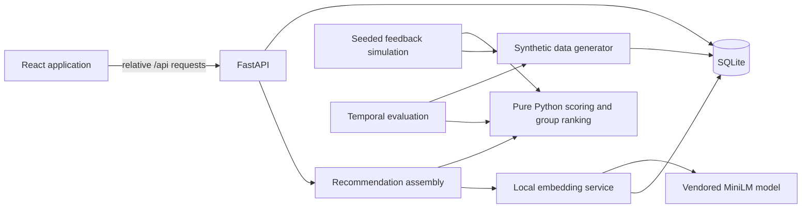

# Quorum

## Project Overview

Quorum helps college clubs choose events that fit member interests, availability, and group needs. It ranks event types and feasible dates and times, then gives organizers evidence for comparing and scheduling recommendations. The application runs locally and uses reproducible synthetic data for development and evaluation.

## Key Features

- Member preferences, weekly availability, and scheduling dealbreakers.
- Organizer recommendations with configurable group strategies, quorum, fairness, and diversity.
- Scheduling constraints for member availability, existing events, holidays, exam periods, and quorum.
- RSVP, attendance, and rating feedback that informs later recommendations.
- Deterministic explanations and counterfactuals based on computed evidence.
- Local authentication, SQLite persistence, and a vendored text-embedding model; no hosted services required.

## Tech Stack

- **Backend:** Python 3.11+, FastAPI, SQLAlchemy 2.x, SQLite.
- **Recommendation and evaluation:** NumPy, pandas, SciPy, scikit-learn, pytest, matplotlib.
- **Local semantic features:** sentence-transformers with CPU PyTorch and a vendored `all-MiniLM-L6-v2` model.
- **Frontend:** React 18 and Vite 8.

Python and npm dependencies are pinned in `requirements.txt` and `package-lock.json`.

## System Architecture



FastAPI serves the built frontend and API from one origin. During development, Vite proxies `/api` to FastAPI. Recommendation scoring is separated from database access and model inference in `backend/recsys`.

## Recommendation Engine

Member-event scores combine explicit event-type ratings, recency-weighted attendance, smoothed weekday/hour affinity, and (by default) similarity between local text embeddings of previously attended events and the candidate event description. History is restricted to the scoring cutoff. Evidence confidence controls each component's contribution; a member with no evidence falls back to club popularity and is marked cold start. Model files are loaded locally, and embeddings are cached in SQLite. Set `QUORUM_EMBEDDINGS_ENABLED=false` to disable this component.

Candidate generation checks availability, latest-start dealbreakers, existing-event conflicts, holidays, exam weeks, and expected attendance against quorum. Feasible candidates are ranked with average, least misery, most pleasure, multiplicative, Borda, approval voting, or average-without-misery. Optional fairness weighting prioritizes members with lower past satisfaction; MMR reranking reduces repeated event types. Explanations are deterministic templates over the computed evidence.

## Installation & Setup

Prerequisites: Python 3.11+, Node.js 20.19+, and npm.

```sh
npm ci
python -m pip install -r requirements.txt
cd backend
python -m app.seed --seed 42
cd ..
python tools/dev.py
```

Open `http://127.0.0.1:5173/app`. The database is created at `data/quorum.db`; seeding with the same value reproduces the same dataset. The generator and evaluation data are synthetic, not real club or member records.

Run checks:

```sh
npm run verify
python -m pytest backend/tests -q
python tools/hardening_check.py
```

Build and run the single-origin application:

```sh
npm run build
python -m uvicorn app.main:app --app-dir backend --host 127.0.0.1 --port 8000
```

## Evaluation

`backend/evaluation/runner.py` uses chronological 70/15/15 train, validation, and test splits across five seeds; tuning uses validation data only. Metrics include Precision@K, Recall@K, NDCG@K, event-type/slot hit rate, satisfaction, quorum success, Brier score, coverage, and intra-list diversity. Full results are in [`results/evaluation/REPORT.md`](results/evaluation/REPORT.md).

Reproduce the evaluation from the repository root:

```sh
cd backend
python -m evaluation.runner --seeds 42 43 44 45 46 --output ../results/evaluation
```

Against the validation-selected club-popularity baseline, the model's mean satisfaction was higher by **0.037** (paired 95% CI **[0.013, 0.061]**). Precision@3 was lower by 0.017, with an interval crossing zero; Brier score was worse (0.209 vs. 0.191, where lower is better). In the embedding ablation, predicted mean satisfaction rose by 0.097 (95% CI [0.093, 0.101]), while event-type hit-rate change was not significant and Brier score worsened.

These results are based only on synthetic behavior and descriptions. They are weak evidence and do not establish real-world improvements; offline history also cannot reveal attendance for events that were not held.

## Project Structure

```text
backend/
  app/             FastAPI routes, auth, persistence, and workflow
  recsys/          Pure scoring, candidate assessment, group ranking, explanations
  synthetic_data/  Seeded synthetic behavior and dataset generation
  simulation/      Recommendation/attendance/feedback simulation
  evaluation/      Temporal metrics, baselines, and reports
  tests/           Backend test suite
  models/          Vendored local embedding model
src/               React application and components
results/evaluation/ CSV metrics, report, and figures
data/               Local SQLite database (generated, git-ignored)
```
